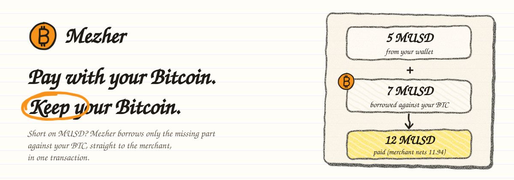
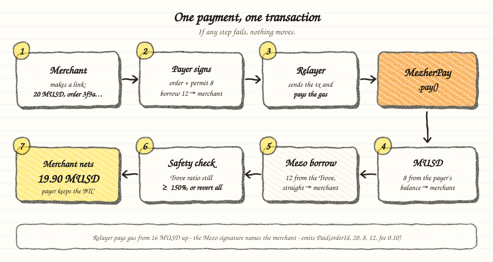

<p align="center">
  
</p>


<p align="center">
  <b>A Bitcoin-backed checkout on Mezo (testnet).</b><br>
  Pay a merchant in MUSD. Whatever your balance doesn't cover is borrowed against your BTC, straight to the merchant, in one transaction.
</p>

<p align="center">
  <a href="https://mezher.vercel.app"><b>Live app</b></a> ·
  <a href="https://mezher.vercel.app/try">Try it</a> ·
  <a href="https://mezher.vercel.app/proof">Proof</a> ·
  <a href="https://explorer.test.mezo.org/address/0xF113519362677fc0BDE15B172FF22DD8dB30aF27?tab=contract">Contract v2 (verified, partial match)</a> ·
  <a href="https://explorer.test.mezo.org/tx/0xbd5855f0d7c0a322c584597f81296e0be3a56c434c50c378879ef6b17336dfd0">Open Trove and pay on testnet</a> ·
  <a href="https://www.youtube.com/watch?v=Y6cAobzL7g8">Wave 1 demo video</a> ·
  <a href="https://drive.google.com/file/d/1n_nNus2p2HWk6ShxbhdL81uJr6z7KvDw/view?usp=sharing">Wave 1 deck</a> ·
  <a href="#getting-started">Run it</a> ·
  <a href="#safety">Safety</a> ·
  <a href="docs/BUSINESS.md">Business model</a> ·
  <a href="docs/evidence.md">Evidence</a>
</p>

---

## Contents

- [Why Mezher](#why-mezher)
- [How it works](#how-it-works)
- [What it uses from Mezo](#what-it-uses-from-mezo)
- [Safety](#safety)
- [Deployments](#deployments)
- [Try it and proof](#try-it-and-proof)
- [Integrate](#integrate)
- [Getting started](#getting-started)
- [Testing](#testing)
- [Project structure](#project-structure)
- [Status and limits](#status-and-limits)

## Why Mezher

People who hold Bitcoin on Mezo can borrow MUSD against it, but spending that credit at a shop still takes several steps: borrow to your wallet, wait, then send a payment, and pay gas each time. The easy path is to sell BTC instead, which is exactly what a Bitcoin holder wants to avoid.

That is one reason. The Mezo mainnet data shows another, and it is not only about having somewhere to spend ([commands and numbers](docs/evidence.md#why-it-matters-mezo-mainnet-numbers), read on 3 Nov 2026):

- **Little MUSD reaches users through Troves.** Of 29.5M MUSD, 14.2M (48%) sits in the Stability Pool; Troves hold 18.6k MUSD of debt across 3 open Troves.
- **Many Troves were closed by redemptions.** Open Troves went from 104 (block 5,000,000, 30 Nov 2025) to 43 (14 Jul 2026) to 1 (25 Oct 2026); we did not examine the 104 to 43 period. In the newest 1,000 transactions sent to the TroveManager (16 Jul to 28 Oct 2026) there are 991 `redeemCollateral` calls: 279 succeeded and 712 reverted (receipt status 0). The 279 redeemed 2,308,919 MUSD for 31.72 BTC from 17 senders and closed 58 Troves (34 distinct borrowers). We did not establish why people redeem, and we did not verify claims in other teams' READMEs that MUSD trades near $0.989.

**What redemption means for a Mezher payer.** Anyone can swap MUSD for BTC against the lowest-ratio Troves first. That cuts the Trove's debt and its BTC, so a borrower with a thin ratio can lose BTC at face value without being liquidated. Borrowing to pay does not cause it, but a payment that lowers your ratio moves your Trove closer to the front of that queue.

**What Mezher does about it.** Checkout shows the Trove's place in the redemption queue and the debt ahead of it. The quote refuses a borrow that would break the 150% floor, Mezo's Recovery Mode rule or the Trove's borrowing capacity, before you sign; when capacity is the limit it points to refinance on the dashboard. This reduces surprises. It does not remove redemption risk, and Mezher cannot stop a redemption.

Mezher turns the purchase into one checkout:

- **Keep your Bitcoin.** Your BTC stays locked in your Trove; only the missing MUSD is borrowed.
- **One transaction.** Your balance part and the borrowed part reach the merchant together, or nothing moves.
- **Gas covered on larger payments.** You sign; for payments of 16 MUSD and up a relayer sends the transaction and pays the gas. Opening a Trove at checkout, and payments under 16 MUSD, use your own gas.
- **A floor on payments through Mezher.** A payment sent through `MezherPay` reverts if it would leave your Trove under 150%. The floor does not cover a Mezo borrow signature used on its own, see [Safety](#safety).

## How it works

<p align="center">
  
</p>

The picture shows a 20 MUSD order split 8 + 12 in v2. The banner shows an illustrative 5 + 7 = 12 split; in v2 the merchant receives the amount minus the 0.5% fee. The payer signs one to three messages: always the order, a permit if the balance part is not already allowed, and Mezo's borrow signature if anything is borrowed.

1. **The merchant creates a link** on `/merchant`, with an amount and an order id (and a QR code for a counter). The merchant activates payments once with a signed permit that allows the fee (50 bps).
2. **The payer opens it** on `/pay` and sees the exact split: what comes from their MUSD balance, what gets borrowed, Mezo's 0.1% fee, their collateral ratio before and after, and where the Trove sits in the redemption queue.
3. **The payer signs** an EIP-712 `Order` (payer, merchant, amount, split, ratio floor, order id, deadline), an MUSD permit for the balance part and Mezo's `WithdrawMUSD` message for the borrowed part, with the merchant as recipient. An EVM wallet is required, see below.
4. **`MezherPay.pay()` runs.** A relayer sends it for payments of 16 MUSD and up. It moves the balance part, borrows the rest from the payer's Trove directly to the merchant, checks the ratio, pulls the fee from the merchant and emits `Paid`.
5. **The merchant sees the payment** on `/merchant` within a few seconds (amount, fee and net received), and the link now shows "Already paid".
6. **Both sides track it on `/dashboard`**: merchants see what they received per day and how much was borrowed against their customers' BTC; payers see their Trove health, liquidation price and room left before the 150% line.

**No Trove yet?** A Mezo Trove needs 2,000 MUSD of total debt (1,800 MUSD minimum borrow plus 200 gas compensation, with the fee on top). A payer without a Trove cannot borrow 20 MUSD for a coffee. Mezher treats the Trove as a credit line: `openAndPay` opens it inside the checkout and pays the merchant from it in the same transaction. The rest of the borrowed MUSD stays with the payer, and later payments borrow only the gap. The payer sends that transaction and pays its gas ([testnet example](https://explorer.test.mezo.org/tx/0xbd5855f0d7c0a322c584597f81296e0be3a56c434c50c378879ef6b17336dfd0)).

**An EVM wallet is required.** Bitcoin wallets (Unisat, OKX, Xverse through OrangeKit) cannot pay or activate: Mezo's signatures are ECDSA only and OrangeKit does not sign typed data. They can connect, and the app tells them to switch to an EVM wallet such as MetaMask.

## What it uses from Mezo

| Mezo component | Used for |
| --- | --- |
| `MUSD` (ERC20Permit, domain "Mezo USD" v1) | Moving the balance part with a signed permit |
| `BorrowerOperationsSignatures.withdrawMUSDWithSignature` | Borrowing on the payer's behalf with the **merchant as recipient** (EIP-712 `WithdrawMUSD`, nonce + deadline) |
| `BorrowerOperationsSignatures` open-Trove signature, `BorrowerOperations.openTrove` | Opening a Trove from the checkout (`openAndPay`) |
| `HintHelpers`, `SortedTroves` | Hints for re-sorting the Trove after the borrow, and the redemption-queue position shown at checkout |
| `TroveManager`, `PriceFeed` | Reading the Trove and enforcing the 150% floor after the borrow |

## Safety

Enforced on-chain by [`MezherPay.sol`](contracts/src/MezherPay.sol) for payments sent through it:

- **Signed order.** Money moves only as an EIP-712 `Order` signed by the payer says: payer, merchant, amount, split, ratio floor, order id and deadline. An order settles once.
- **Ratio floor.** After borrowing, the payer's Trove must stay at an ICR of at least 150% (or the higher floor in the order), or the whole payment reverts (`IcrBelowFloor`). The UI blocks payments below 150.5%.
- **Money only goes to the merchant the payer signed for.** Mezo's borrow signature binds the recipient, so neither the relayer nor a front-runner can redirect it.
- **No owner, no upgrades, no custody.** The contract holds no funds between calls.

**The floor is not universal.** A Mezo borrow signature used on its own, submitted straight to Mezo by someone who sees it, delivers the money to the signed merchant but skips Mezher's fee, `Paid` event and 150% floor; only Mezo's rules apply (110% and Recovery Mode). The matching `pay` then reverts. Details: [docs/SECURITY.md](docs/SECURITY.md#known-limits).

**Not audited.** MezherPay has had one AI agent's manual review, an invariant suite and a Slither run. That is not a professional audit. Testnet only; do not use real funds.

The relay endpoint ([`web/lib/relay.ts`](web/lib/relay.ts)) validates every request, rate-limits per payer and IP, de-duplicates orders, simulates before sending, and never logs signatures. The findings, their status and the Slither results are in [docs/SECURITY.md](docs/SECURITY.md).

## Deployments

Mezo testnet (chain id `31611`, RPC `https://rpc.test.mezo.org`).

| Contract | Address |
| --- | --- |
| **MezherPay v2** | [`0xF113519362677fc0BDE15B172FF22DD8dB30aF27`](https://explorer.test.mezo.org/address/0xF113519362677fc0BDE15B172FF22DD8dB30aF27?tab=contract) (source verified as a partial match, block 16544459, [deploy tx](https://explorer.test.mezo.org/tx/0x529f2cd5dab578f4fe57df3a14ffb2adb79e2197ee95af62182e8718e0c80b8a), fee 50 bps) |
| MezherPay v1 (Wave 1, superseded) | [`0x80ddA1a82Bb291348d4b5Ef33FAc10819071f58b`](https://explorer.test.mezo.org/address/0x80ddA1a82Bb291348d4b5Ef33FAc10819071f58b?tab=contract) |
| MUSD | `0x118917a40FAF1CD7a13dB0Ef56C86De7973Ac503` |
| BorrowerOperationsSignatures | `0xD757e3646AF370b15f32EB557F0F8380Df7D639e` |
| BorrowerOperations | `0xCdF7028ceAB81fA0C6971208e83fa7872994beE5` |
| TroveManager | `0xE47c80e8c23f6B4A1aE41c34837a0599D5D16bb0` |

## Try it and proof

- **[`/try`](https://mezher.vercel.app/try)** takes a wallet with test BTC (from the [Mezo faucet](https://faucet.test.mezo.org)) through a 20 MUSD payment to a demo merchant, and offers the path that fits the wallet: open a Trove and pay, pay from balance, part balance and part borrowed, or fully borrowed. It needs an EVM wallet, and it does not offer a payment from the demo merchant's own wallet.
- **[`/proof`](https://mezher.vercel.app/proof)** reads every `Paid` event from the chain and counts payers and merchants. "Team" is a wallet we control, "outside" is anyone else.

**Team-wallet proofs on v2** (our own wallets, testnet, read from the chain; more in [docs/evidence.md](docs/evidence.md)):

| Path | Tx |
| --- | --- |
| `openAndPay`: 1,800 MUSD Trove opened, 20 MUSD paid, payer paid the gas; a permit (Approval of 20) | [`0xbd5855f0…`](https://explorer.test.mezo.org/tx/0xbd5855f0d7c0a322c584597f81296e0be3a56c434c50c378879ef6b17336dfd0) |
| Split `pay` via relayer: 1,785 MUSD = 1,780 balance + 5 borrowed; a permit (Approval of 1,780) | [`0x82dc5bd3…`](https://explorer.test.mezo.org/tx/0x82dc5bd34e8a0b0a28aef153dc254d734293ede829c061ced1310904847c831d) |
| Fully borrowed `pay` via relayer: 20 MUSD | [`0xbb14adf9…`](https://explorer.test.mezo.org/tx/0xbb14adf9d23f25d1bf5b1b9d9d1fb816c1d1a42bd2ae51b96efd090a6a77518c) |
| Balance-only `pay` via relayer: 20 MUSD, a self-payment by the demo merchant wallet; no permit, it used the existing activation allowance | [`0x0b1cbd3b…`](https://explorer.test.mezo.org/tx/0x0b1cbd3b070911af42a36f4a45a9336cb11d3163186f134239ef769045fb9948) |

**Outside users so far: 0.** Every payment above comes from team wallets, including `0xeff1…abf4`, and `/proof` labels them as team.

## Integrate

**On a website, no code:** create a link on `/merchant` and copy the "Add it to your site" snippet. One tag renders a "Pay with Bitcoin" button that opens the checkout in a new tab:

```html
<script src="https://mezher.vercel.app/embed.js"
        data-to="0xYourAddress" data-amount="20" data-order="3f9a1c0d2b4e5f60" data-label="Coffee" async></script>
```

**On chain:** `MezherPay` is a public building block: any wallet, app or protocol can submit a payment with the payer's signatures. Read [`MezherPay.sol`](contracts/src/MezherPay.sol) for the exact structs; in short:

```solidity
function pay(Order calldata o, bytes calldata orderSig, PermitSig calldata permit, BorrowSig calldata borrow) external;
function openAndPay(Order calldata o, bytes calldata orderSig, PermitSig calldata permit, OpenSig calldata open) external payable;
```

The `Order` carries payer, merchant, amount, `fromBalance`, `minIcrAfter`, `orderId` and `deadline`. Events: `Paid` (with the fee) and, for `openAndPay`, `OpenedAtCheckout`.

Ready-made helpers (TypeScript, viem):

| File | What |
| --- | --- |
| [`web/lib/signatures.ts`](web/lib/signatures.ts) | EIP-712 typed data for the order, the MUSD permit and Mezo `WithdrawMUSD` / open-Trove |
| [`web/lib/hints.ts`](web/lib/hints.ts) | Trove hints for the borrow |
| [`web/lib/quote.ts`](web/lib/quote.ts) | Split, fee and ratio math, with the 150.5% floor, Recovery Mode and borrowing capacity |
| [`web/lib/abi/MezherPay.ts`](web/lib/abi/MezherPay.ts) | Typed ABI |

## Getting started

**Requirements:** Node.js, [pnpm](https://pnpm.io), [Foundry](https://book.getfoundry.sh) (for the contracts).

```bash
git clone https://github.com/woydarko/mezher.git
cd mezher/web
pnpm install
cp .env.example .env.local
pnpm dev
```

Then open http://localhost:3000 (or use the live app at https://mezher.vercel.app). Fill `.env.local` with:

| Variable | Value |
| --- | --- |
| `NEXT_PUBLIC_MEZHER_PAY_ADDRESS` | `0xF113519362677fc0BDE15B172FF22DD8dB30aF27` |
| `NEXT_PUBLIC_MEZHER_PAY_DEPLOY_BLOCK` | `16544459` |
| `NEXT_PUBLIC_DEMO_MERCHANT` | the demo merchant address; `/try` needs it |
| `RELAYER_PRIVATE_KEY` | a burner key with a little test BTC, **server only**, never committed |

`.env.example` lists the optional ones (team wallets). To pay, use an EVM wallet on Mezo testnet: get test BTC from the [Mezo faucet](https://faucet.test.mezo.org), then open a Trove in the checkout.

## Testing

Counts from `forge test --list` and `vitest run`, 3 Nov 2026.

| Suite | Command | Covers |
| --- | --- | --- |
| Contract unit (53) | `cd contracts && forge test --match-contract MezherPayTest` | Split, permit front-run, signature checks, ICR floor, redirect attempts, `openAndPay`, fee and allowance |
| Contract invariants (11) | `cd contracts && forge test --match-path test/MezherPay.invariant.t.sol` | Foundry default of 256 runs of 500 calls each: honest splits, ratio moves around 150%, redirect attempts; no funds held, exact amounts, fees, no borrow under the floor |
| Contract fork, testnet (6) | `cd contracts && MEZO_TESTNET_RPC_URL=https://rpc.test.mezo.org forge test --match-path test/MezherPay.fork.t.sol` | The real Mezo contracts on a testnet fork: 5 + 7 split, `openAndPay`, replay, ICR floor, redirect |
| Contract fork, mainnet (1) | `cd contracts && MEZO_MAINNET_RPC_URL=<mainnet rpc> forge test --match-path test/MezherPay.mainnetFork.t.sol` | Open, pay and borrow-to-pay on a Mezo mainnet fork (skipped without the variable) |
| Web unit (179) | `cd web && pnpm vitest run` | Link parsing, quote, ratio, Recovery Mode and capacity, Trove opening, signatures, hints, relay, checkout state, payment logs, `/proof` and `/try` helpers, QR, embed button |
| Build | `cd web && pnpm build` | Type check and production build |

Mezo's price oracle is a native precompile that Foundry's EVM does not have, so the fork tests pin `PriceFeed.fetchPrice()` to the live price. Every other contract in those tests is the real one.

## Project structure

```
contracts/
  src/MezherPay.sol        the product contract (v2)
  test/                    unit, invariant (mocks) and fork tests (real Mezo testnet and mainnet)
  script/Deploy.s.sol      deployment script
web/
  app/                     Next.js pages: / landing, /pay, /try, /proof, /merchant, /dashboard, /terms; API routes /api/relay, /api/activate, /api/faucet
  components/              crayon UI components
  lib/                     link, quote, Trove, redemption, signatures, hints, relay, proof, payment logs (unit tested)
  scripts/mezo-stats.mjs   read-only Mezo mainnet MUSD, Trove and redemption numbers
  scripts/pay-cost.mjs     relayer gas cost per payment and break-even size
docs/
  BUSINESS.md              fee model, measured gas, break-even
  evidence.md              every claim with a link or a command
  SECURITY.md              properties, findings, known limits, Slither results
  assets/                  README illustrations
```

**Stack:** Solidity 0.8.28 (EVM london), Foundry, OpenZeppelin 5 · Next.js 14, React 18, viem, wagmi, RainbowKit with Mezo Passport · vitest.

## Status and limits

**Now (Wave 2):** MezherPay v2 on Mezo testnet with a signed order, a 50 bps merchant fee, merchant activation, `openAndPay`, split and fully borrowed payments, a quote that handles Recovery Mode, redemption position and borrowing capacity, `/try` and `/proof`. All checkout paths have a testnet transaction (table above), made from team wallets.

**Known limits**
- Testnet only, no real funds. Not professionally audited: one AI agent's review, an invariant suite and a Slither run.
- Outside users: 0 so far (see above). No merchant has accepted the fee, and there is no revenue.
- A Mezo borrow signature used alone skips the fee, `Paid` and Mezher's floor; see [Safety](#safety) and [docs/SECURITY.md](docs/SECURITY.md#known-limits).
- EVM wallets only. Bitcoin wallets cannot sign the typed data.
- A Trove needs 2,000 MUSD of total debt, so a payer without one opens a Trove at checkout and pays the gas for it.
- Redemption can reduce a Trove's debt and BTC; Mezher shows the position but cannot prevent it.
- The relay keeps its rate limit in memory per server instance.
- Unpaid orders live only inside their link; there is no database yet.
- The Lighthouse run we did covered only the connect gate on `/pay` and `/merchant`, not the full flows.

**Next**
- Order lookup and merchant notifications (needs a small database).
- Pay for APIs and agents over x402-style requests with borrowed MUSD.
- A professional audit before any mainnet deployment.

## Credits

- [OpenZeppelin Contracts](https://github.com/OpenZeppelin/openzeppelin-contracts) 5.1 (MIT) and [forge-std](https://github.com/foundry-rs/forge-std) are vendored in `contracts/lib/` with their licenses.
- [Shantell Sans](https://github.com/arrowtype/shantell-sans) (SIL Open Font License 1.1) is the UI typeface and is embedded in the README illustrations.
- Built on [Mezo](https://mezo.org) and its MUSD contracts ([mezo-org/musd](https://github.com/mezo-org/musd)).
