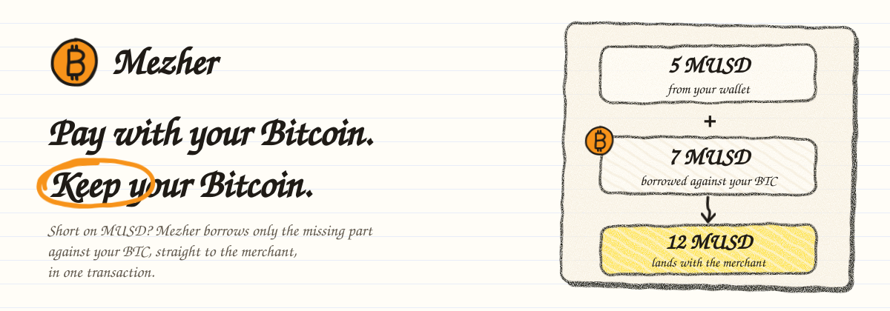
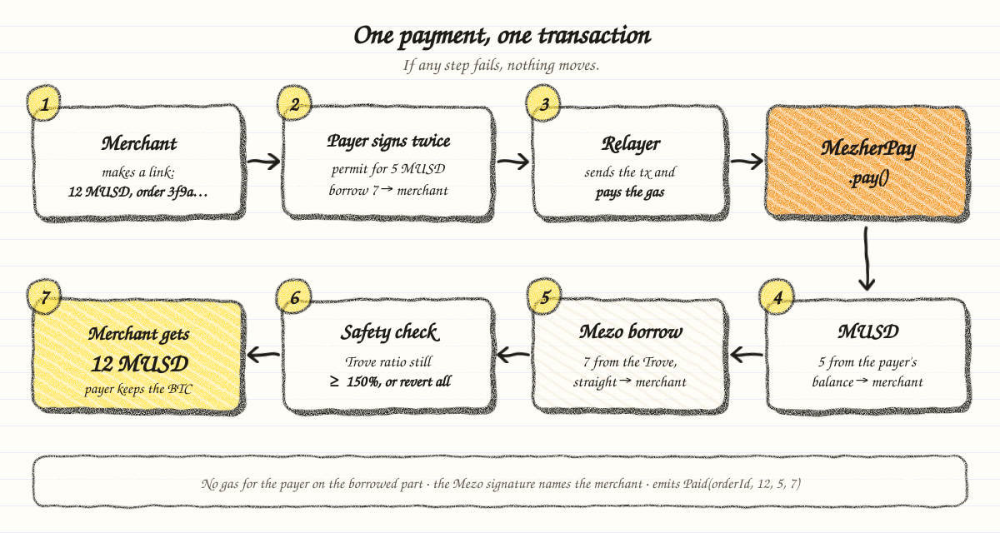

<p align="center">
  
</p>

<p align="center">
  <b>A Bitcoin-backed checkout on Mezo.</b><br>
  Pay a merchant in MUSD. Whatever your balance doesn't cover is borrowed against your BTC, straight to the merchant, in one transaction.
</p>

<p align="center">
  <a href="https://explorer.test.mezo.org/address/0x80ddA1a82Bb291348d4b5Ef33FAc10819071f58b?tab=contract">Contract (verified)</a> ·
  <a href="https://explorer.test.mezo.org/tx/0xdb3bc15e4e65c0756eb81c49f91ee1490a568d2fbfc2601a9b5b6b86c2607eb5">Live payment on testnet</a> ·
  <a href="#getting-started">Run it</a> ·
  <a href="#integrate">Integrate</a> ·
  <a href="#safety">Safety</a>
</p>

---

## Contents

- [Why Mezher](#why-mezher)
- [How it works](#how-it-works)
- [What it uses from Mezo](#what-it-uses-from-mezo)
- [Safety](#safety)
- [Deployments](#deployments)
- [Integrate](#integrate)
- [Getting started](#getting-started)
- [Testing](#testing)
- [Project structure](#project-structure)
- [Status and roadmap](#status-and-roadmap)

## Why Mezher

People who hold Bitcoin on Mezo can borrow MUSD against it, but spending that credit at a shop still takes several steps: borrow to your wallet, wait, then send a payment, and pay gas each time. The easy path is to sell BTC instead, which is exactly what a Bitcoin holder wants to avoid.

Mezher turns it into one checkout:

- **Keep your Bitcoin.** Your BTC stays locked in your Trove; only the missing MUSD is borrowed.
- **One transaction.** Your balance part and the borrowed part reach the merchant together, or nothing moves.
- **No gas for the borrowed part.** You sign; a relayer sends the transaction.
- **Safe by default.** The contract refuses any payment that would leave your Trove under a 150% collateral ratio.

## How it works

<p align="center">
  
</p>

1. **The merchant creates a link** on `/merchant`, with an amount and an order id (and a QR code for a counter).
2. **The payer opens it** on `/pay` and sees the exact split: what comes from their MUSD balance, what gets borrowed, Mezo's 0.1% fee, and their collateral ratio before and after.
3. **The payer signs**: an MUSD permit for the balance part and Mezo's `WithdrawMUSD` message for the borrowed part, with the merchant as recipient.
4. **The relayer calls `MezherPay.pay()`**, which moves the balance part, borrows the rest from the payer's Trove directly to the merchant, checks the ratio, and emits `Paid`.
5. **The merchant sees the payment** on `/merchant` within a few seconds, and the link now shows "Already paid".
6. **Both sides track it on `/dashboard`**: merchants see what they received per day and how much was borrowed against their customers' BTC; payers see their Trove health, liquidation price and room left before the 150% line.

No Trove yet? The checkout can open one: lock BTC, borrow at least 1,800 MUSD into your wallet, then pay.

## What it uses from Mezo

| Mezo component | Used for |
| --- | --- |
| `MUSD` (ERC20Permit, domain "Mezo USD" v1) | Moving the balance part with a signed permit |
| `BorrowerOperationsSignatures.withdrawMUSDWithSignature` | Borrowing on the payer's behalf with the **merchant as recipient** (EIP-712 `WithdrawMUSD`, nonce + deadline) |
| `BorrowerOperations.openTrove` | Opening a Trove from the checkout |
| `HintHelpers`, `SortedTroves` | Hints for re-sorting the Trove after the borrow, so Mezo does not search the whole list |
| `TroveManager`, `PriceFeed` | Reading the Trove and enforcing the 150% floor after the borrow |

## Safety

Enforced on-chain by [`MezherPay.sol`](contracts/src/MezherPay.sol):

- **Ratio floor.** After borrowing, the payer's Trove must stay at an ICR of at least 150%, or the whole payment reverts (`IcrBelowFloor`). The UI blocks payments below 150.5%.
- **Money only goes to the merchant the payer signed for.** Mezo's borrow signature binds the recipient, so neither the relayer nor a front-runner can redirect it.
- **Balance-only payments come from the payer.** When nothing is borrowed, the MUSD permit names no merchant, so `pay()` requires the payer to send it (`BalanceOnlyNeedsPayer`).
- **No owner, no upgrades, no custody.** The contract holds no funds between calls.

The relay endpoint ([`web/lib/relay.ts`](web/lib/relay.ts)) validates every request, rate-limits per payer and IP, de-duplicates orders, simulates before sending, and never logs signatures. Known risks are listed under [Status and roadmap](#status-and-roadmap).

## Deployments

Mezo testnet (chain id `31611`, RPC `https://rpc.test.mezo.org`).

| Contract | Address |
| --- | --- |
| **MezherPay** | [`0x80ddA1a82Bb291348d4b5Ef33FAc10819071f58b`](https://explorer.test.mezo.org/address/0x80ddA1a82Bb291348d4b5Ef33FAc10819071f58b?tab=contract) (verified, block 16241205) |
| MUSD | `0x118917a40FAF1CD7a13dB0Ef56C86De7973Ac503` |
| BorrowerOperationsSignatures | `0xD757e3646AF370b15f32EB557F0F8380Df7D639e` |
| BorrowerOperations | `0xCdF7028ceAB81fA0C6971208e83fa7872994beE5` |
| TroveManager | `0xE47c80e8c23f6B4A1aE41c34837a0599D5D16bb0` |

Reference payment: [`0xdb3bc15e…`](https://explorer.test.mezo.org/tx/0xdb3bc15e4e65c0756eb81c49f91ee1490a568d2fbfc2601a9b5b6b86c2607eb5), 11 MUSD borrowed from the payer's Trove straight to the merchant, sent by the relayer.

## Integrate

`MezherPay` is a public building block: any wallet, app or protocol can submit a payment with the payer's signatures.

```solidity
struct Payment   { address payer; address merchant; uint256 amount; uint256 fromBalance; bytes32 orderId; }
struct PermitSig { uint256 deadline; uint8 v; bytes32 r; bytes32 s; }                         // ignored if fromBalance == 0
struct BorrowSig { address upperHint; address lowerHint; uint256 deadline; bytes signature; } // ignored if nothing is borrowed

function pay(Payment calldata p, PermitSig calldata permit, BorrowSig calldata borrow) external;

event Paid(bytes32 indexed orderId, address indexed payer, address indexed merchant,
           uint256 amount, uint256 fromBalance, uint256 borrowed);
```

Ready-made helpers (TypeScript, viem):

| File | What |
| --- | --- |
| [`web/lib/signatures.ts`](web/lib/signatures.ts) | EIP-712 typed data for the MUSD permit and Mezo `WithdrawMUSD` |
| [`web/lib/hints.ts`](web/lib/hints.ts) | Trove hints for the borrow |
| [`web/lib/quote.ts`](web/lib/quote.ts) | Split, fee and ratio math, including the 150.5% floor |
| [`web/lib/abi/MezherPay.ts`](web/lib/abi/MezherPay.ts) | Typed ABI |

## Getting started

**Requirements:** Node.js, [pnpm](https://pnpm.io), [Foundry](https://book.getfoundry.sh) (for the contracts).

```bash
git clone https://github.com/woydarko/mezher.git
cd mezher/web
pnpm install
cp .env.example .env.local
pnpm dev
```

Then open http://localhost:3000. Fill `.env.local` with:

| Variable | Value |
| --- | --- |
| `NEXT_PUBLIC_MEZHER_PAY_ADDRESS` | `0x80ddA1a82Bb291348d4b5Ef33FAc10819071f58b` |
| `NEXT_PUBLIC_MEZHER_PAY_DEPLOY_BLOCK` | `16241205` |
| `NEXT_PUBLIC_DEMO_MERCHANT` | any address that should receive the demo payment |
| `RELAYER_PRIVATE_KEY` | a burner key with a little test BTC, **server only**, never committed |

To pay, use a wallet on Mezo testnet: get test BTC from the [faucet](https://faucet.test.mezo.org), then open a Trove in the checkout or at [testnet.mezo.org](https://testnet.mezo.org).

## Testing

| Suite | Command | Covers |
| --- | --- | --- |
| Contract unit (17) | `cd contracts && forge test --match-contract MezherPayTest` | Split, permit front-run, signature checks, ICR floor, redirect attempts |
| Contract fork (4) | `cd contracts && MEZO_TESTNET_RPC_URL=https://rpc.test.mezo.org forge test --match-path test/MezherPay.fork.t.sol` | The real Mezo contracts on a testnet fork: 5 + 7 split, replay, ICR floor, redirect |
| Web unit (87) | `cd web && pnpm vitest run` | Link parsing, quote and ratio, Trove opening, signatures, hints, relay, checkout state, payment logs, dashboard stats, QR |
| Build | `cd web && pnpm build` | Type check and production build |

Mezo's price oracle is a native precompile that Foundry's EVM does not have, so the fork tests pin `PriceFeed.fetchPrice()` to the live price. Every other contract in those tests is the real one.

## Project structure

```
contracts/
  src/MezherPay.sol        the product contract
  test/                    unit tests (mocks) and fork tests (real Mezo testnet)
  script/Deploy.s.sol      deployment script
web/
  app/                     Next.js pages: / landing, /pay checkout, /merchant, /dashboard, /terms, /api/relay
  components/              crayon UI components
  lib/                     link, quote, Trove, signatures, hints, relay, payment logs (all unit tested)
docs/assets/               README illustrations
```

**Stack:** Solidity 0.8.28 (EVM london), Foundry, OpenZeppelin 5 · Next.js 14, React 18, viem, wagmi, RainbowKit with Mezo Passport · vitest.

## Status and roadmap

**Now (Wave 1):** working on Mezo testnet, end to end: payment links with QR, gasless borrow-to-pay checkout, in-app Trove opening, and a dashboard for merchants and payers built from on-chain data.

**Known limits**
- Testnet only. MezherPay has had an AI-assisted security review, not a professional audit.
- Opening a Trove from the checkout is unit tested and checked against testnet with `eth_call`; it has not yet been run end to end from the UI.
- The relay keeps its rate limit in memory per server instance.
- Unpaid orders live only inside their link; there is no database yet.

**Next**
- Order lookup and merchant notifications (needs a small database).
- Pay for APIs and agents over x402 with borrowed MUSD.
- A professional audit before any mainnet deployment.

## Credits

- [OpenZeppelin Contracts](https://github.com/OpenZeppelin/openzeppelin-contracts) 5.1 (MIT) and [forge-std](https://github.com/foundry-rs/forge-std) are vendored in `contracts/lib/` with their licenses.
- [Shantell Sans](https://github.com/arrowtype/shantell-sans) (SIL Open Font License 1.1) is the UI typeface and is embedded in the README illustrations.
- Built on [Mezo](https://mezo.org) and its MUSD contracts ([mezo-org/musd](https://github.com/mezo-org/musd)).
